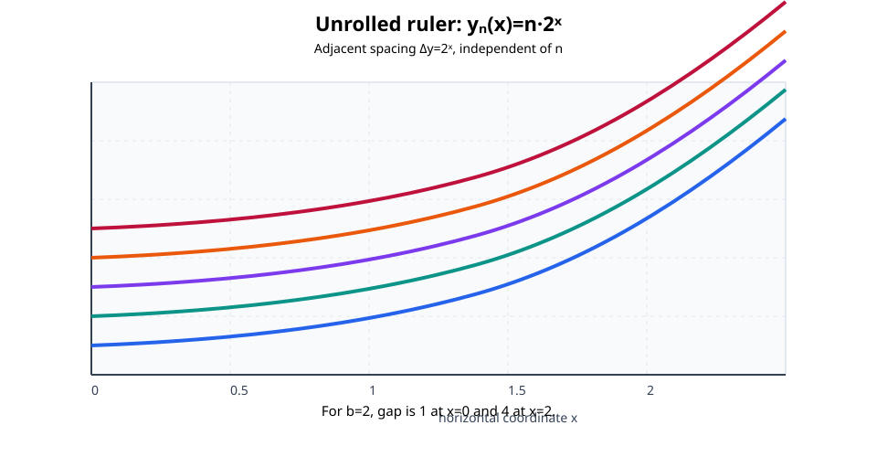
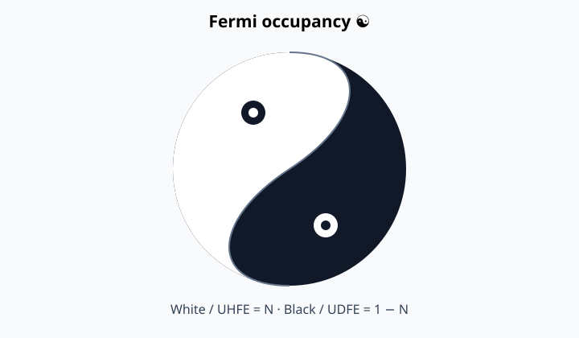

# Feynman–Barbershop ruler and V8 parameter-response experiment

**Canonical geometry supplied by the project owner:** y_n(x)=n b^x, b>0, b≠1.

## Ruler law

\[
y_n(x)=n b^x,\qquad \Delta y=y_{n+1}-y_n=(n+1)b^x-nb^x=b^x.
\]
The line index cancels exactly. At x=0 the gap is 1; at x=2 it is b². For any positive target length L, the unique cursor coordinate is x=log_b(L).

The proposed cylinder and sliding cursor are a mechanical visualization. A physical prototype still needs cylinder radius, angular mapping, seam treatment and calibration before metrological accuracy can be claimed.

## Feynman parameter layer

\[
B_n(x,\lambda,b)=n b^{\lambda x},\quad
Z(\lambda)=\sum_{n=1}^{N}\int_{x_0}^{x_1}e^{-\beta B_n}\,dx.
\]
Z is an analysis functional, not a physical partition function. On a finite interval and finite mode set, its smooth bounded integrand permits differentiation under the integral sign:
\[
\partial_\lambda B_n=x\ln(b)B_n,\quad
Z'=-\beta\ln(b)\sum_n\int xB_ne^{-\beta B_n}dx,
\]
\[
Z''=-\beta(\ln b)^2\sum_n\int x^2B_n(1-\beta B_n)e^{-\beta B_n}dx.
\]
Lambda is an analytical control parameter, not a ninth V8 coordinate.

## ☯️ Updated Fermi occupancy geometry

The yin-yang model is a separate encoding of coupled UHFE/UDFE: white formation area N and black dissolution area 1-N in a unit disk. Its existing implementation and tests are in [Kernel PR #50](https://github.com/SireLuke/pan-fractal-kernel/pull/50). Eye/lemniscate marks are decorative and excluded from area accounting.

Janus Hydra remains the fractal-geometric semantic translator, not UHFE/UDFE. V8 order remains (h,R,u,d,tau,chi,s,f); no implicit mapping from ruler indices to V8 coordinates or E8 roots is assumed.

## Validation

Tests cover exact adjacent-gap cancellation, base-general spacing, logarithmic cursor inversion, reciprocal-base identity, Feynman first/second derivatives against central finite differences, eight-mode output and invalid inputs. These validate software identities and numerical derivatives, not metrological accuracy or new physics.
